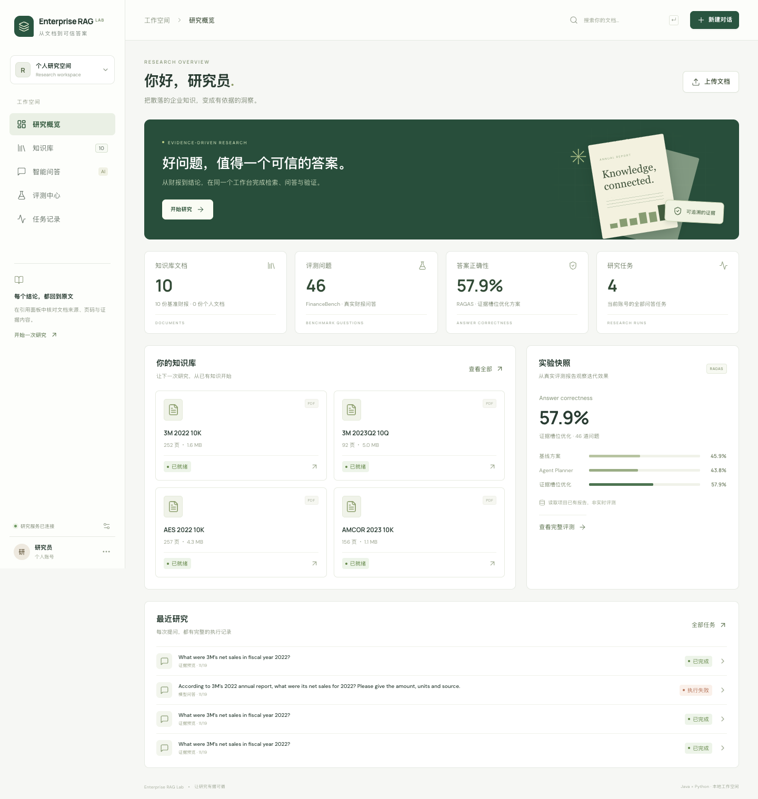

# Enterprise RAG Lab

企业财报 RAG 研究平台：React / TypeScript 前端、Spring Boot 业务后端、Python 检索服务与 MySQL。



## 全栈平台

- 注册登录、JWT 与退出失效，按用户隔离会话、文档和任务。
- 财报目录、私有文档上传解析、文件预览、会话管理、来源与页码查看。
- REST / SSE 跨语言调用、实时执行状态、幂等请求、取消与中断处理。
- 真实 FinanceBench / RAGAS 实验对比、逐题检查、任务记录。
- 原检索与证据门控算法保留，新增应用代码集中在 `platform/`。

### 本地运行

安装 JDK 21、Maven、Node.js 与 Docker Desktop。准备原 Python 环境后：

```bash
uv sync --extra dev
uv pip install --python .venv/bin/python -r platform/agent_service/requirements.txt
python3 platform/scripts/platform.py build
python3 platform/scripts/platform.py start
```

访问 **http://127.0.0.1:9080**。本地演示账号 `demo@raglab.local`，密码 `RagLab2026!`。

数据库密码、JWT 密钥和内部凭证在首次启动时随机生成，仅保存于 git 忽略的 `platform/.env`。源码不包含真实密钥、用户上传资料、数据库、向量索引或模型权重。

没有模型凭证也可上传文档并使用证据预览。模型问答需配置本地 `src/.env`，认证失败会明确报错，不会返回模拟生成结果。公开部署前请关闭演示账号并配置 HTTPS。

FinanceBench PDF 和原向量索引不随仓库分发；可按下方数据准备步骤恢复，也可先上传个人测试文档验证平台。页面对比所需的六份固定评测报告已随代码保留。

完整说明：[平台 README](platform/README.md) · [验证记录](platform/docs/verification.md)

## 原 RAG 研究项目说明

This is a [LlamaIndex](https://www.llamaindex.ai/) project that using [Workflows](https://docs.llamaindex.ai/en/stable/understanding/workflows/) deployed with [LlamaDeploy](https://github.com/run-llama/llama_deploy).

LlamaDeploy is a system for deploying and managing LlamaIndex workflows, while LlamaIndexServer provides a pre-built TypeScript server with an integrated chat UI that can connect directly to LlamaDeploy deployments. This example shows how you can quickly set up a complete chat application by combining these two technologies/

## Enterprise RAG Lab Extensions

This project has been extended from the generated template into an enterprise-style
RAG learning lab:

- DeepSeek as the OpenAI-compatible LLM backend.
- FastEmbed/BGE local embeddings.
- Chroma persistent vector database.
- Explicit ingestion pipeline with metadata, hash dedupe, and configurable chunking.
- Two-level text chunks: 384-token children are indexed for retrieval, while
  complete 1024-token parents are persisted for generation.
- BM25 keyword retrieval + Chroma vector retrieval.
- Reciprocal Rank Fusion (RRF) hybrid search.
- BGE cross-encoder reranking behind a stable reranker interface.
- Pre-retrieval tenant, ACL, company, fiscal-period, document-type, and version
  filtering shared by lexical and vector retrieval.
- Parent-child retrieval: retrieve fine-grained chunks or table rows, then return
  their complete parent chunk or parent table with structural boundaries preserved.
- Structure-aware context packing with a global evidence budget, novelty control,
  and source/period metadata constraints to reduce cross-filing conflicts.
- Table-atomic evidence handling: headers and adjacent matching rows stay together;
  table rows use their own BM25/vector/RRF path and tables are never sentence-compressed.
- A non-vector structured-data gateway for current facts, with a parameterized
  SQLite reference adapter and a protocol for production SQL/API adapters.
- Evidence-slot fulfillment, metadata/value conflict detection, and a four-state
  `answered / qualified / conflict / insufficient` generation gate.
- Citation-preserving Agentic RAG workflow.
- Three-layer RAG evaluation: ingestion integrity, retrieval effectiveness,
  and RAGAS generation quality.

Read [STUDY_GUIDE.md](STUDY_GUIDE.md) for the learning roadmap and module map.
The system's retrieval objective, layered data architecture, capability boundaries,
and evidence-gating contract are defined in
[docs/rag_top_level_design.md](docs/rag_top_level_design.md).

## FinanceBench Dataset

This project uses FinanceBench as the first realistic benchmark because it
contains real annual-report PDFs, financial questions, reference answers, and
evidence pages. It is a better resume dataset than toy PDFs because it tests
long-document ingestion, table-heavy retrieval, numerical reasoning evidence,
and citation grounding.

Prepare a lightweight local subset after cloning FinanceBench:

```bash
git clone --depth 1 https://github.com/patronus-ai/financebench.git /private/tmp/financebench
uv run python scripts/prepare_financebench.py \
  --source /private/tmp/financebench \
  --doc-limit 5 \
  --question-limit 20
```

The script copies selected PDFs into `ui/data/financebench/` and writes
`eval/financebench_questions.jsonl`. The PDF directory is git-ignored because
the dataset files are large and can be regenerated.

Rebuild the RAG index and run retrieval evaluation:

```bash
uv run generate
uv run python -m src.eval.run_eval \
  --questions eval/financebench_questions.jsonl \
  --output reports/financebench_eval_report.md \
  --json-output reports/financebench_eval_report.json
```

The retrieval report separates three pre-generation checks:

- **Ingestion integrity**: checks expected-PDF availability, evidence-page
  coverage, page metadata coverage, and chunk-size distribution.
- **Pre-assembly retrieval**: measures all fine-grained child-chunk and table-row
  results selected by the retrieval plan before structural expansion.
- **Assembled evidence retrieval**: measures the parent-chunk and parent-table
  evidence sent to generation, including source hit/MRR, evidence-page hit/MRR,
  and expected-page recall derived from retained metadata. Lexical reference
  coverage is reported only as a lightweight bad-case diagnostic, not as
  semantic evidence recall.

Use this before RAGAS when changing PDF parsing, chunk size/overlap, embeddings,
hybrid retrieval, reranking, parent-child expansion, or table retrieval. RAGAS still
answers "did the generated answer look faithful/relevant/correct"; this report
answers "did ingestion preserve the evidence and did retrieval recall it."

RAGAS evaluates generated answers with faithfulness, answer relevancy, answer
correctness, context precision, context recall, and irrelevant-context noise
sensitivity. Together, the two reports separate evidence availability, retrieval,
and final-answer quality.

Planner output is stored per question in the JSON report. Reuse the exact plans
when comparing retrieval execution changes:

```bash
uv run python -m src.eval.run_eval \
  --questions eval/financebench_questions.jsonl \
  --plans-input reports/financebench_eval_report.json \
  --output reports/financebench_plan_replay.md \
  --json-output reports/financebench_plan_replay.json
```

Run the complete generation evaluation with resumable five-question batches:

```bash
uv run python -m src.eval.run_ragas_eval \
  --questions eval/financebench_questions.jsonl \
  --plans-input reports/financebench_eval_report.json \
  --output reports/ragas_eval_report.md \
  --json-output reports/ragas_eval_report.json \
  --checkpoint-output reports/ragas_eval_checkpoint.json \
  --ragas-batch-size 5
```

Add `--resume` to continue from the checkpoint after an interrupted run. RAGAS
telemetry is disabled by the evaluator; only the configured judge model receives
the evaluation prompts required for scoring.

The generation retriever follows one fixed evidence path:

- an LLM retrieval planner emits a validated intent, metadata scope, evidence
  slots, selected tools, and short retriever-specific semantic queries;
- a deterministic executor runs only the selected chunk, table, structured-data,
  and calculator tools, with a bounded broad-retrieval fallback when planning fails;
- application-owned request context applies tenant, ACL, scope, time, and version
  constraints before candidates can participate in BM25/vector ranking;
- vector and BM25 results from the original question and planned queries are
  fused with RRF and reranked once;
- selected table queries retrieve short rows, rerank those rows, and return the
  matching parent-table window with its header;
- child chunks are the searchable units, while their complete persisted parent
  chunks are returned for generation;
- source and period metadata constraints are applied before the final context is
  packed under one budget.
- the assembled context is checked against each required evidence slot before the
  generator receives an answer permission state.

Runtime access context is configured by the serving layer. Local defaults are:

```dotenv
RAG_TENANT_ID=default
RAG_PRINCIPAL_ID=anonymous
RAG_ACL_SCOPES=public
RAG_DOCUMENT_VERSION=1
STRUCTURED_DATA_DB=
```

When `STRUCTURED_DATA_DB` is set, the reference adapter reads a
`structured_facts` SQLite table containing `id`, `tenant_id`, `acl_scope`,
`company_key`, `fiscal_year`, `quarter`, `metric`, `value`, `unit`,
`source_system`, `observed_at`, `valid_from_epoch`, and `valid_to_epoch`.
These records remain outside Chroma and are filtered with parameterized SQL.

Before generation, retrieved candidates are metadata-constrained when the question
names a company, fiscal year, quarter, or annual filing. Fine-grained hits are then
expanded to their complete parent chunk or parent table and packed jointly under one context
budget. This avoids per-hit sentence compression, which can split table headers
from values or drop the context needed to reconcile related statements.

## RAGAS Regression Gate

After any retrieval, ingestion, reranking, prompt, or calculator change, compare the
candidate RAGAS report against the current best baseline before treating it as an
improvement. The regression gate separates target questions from non-target questions,
so a local fix cannot hide broad correctness regressions.

Example: compare a quick-ratio formula fallback run against the current best
PDF-element-aware baseline:

```bash
uv run python scripts/compare_ragas_runs.py \
  --baseline reports/ragas_eval_full_pdf_element_aware.json \
  --candidate reports/ragas_eval_full_formula_fallback.json \
  --target-pattern "quick ratio" \
  --output reports/formula_fallback_regression_comparison.md \
  --json-output reports/formula_fallback_regression_comparison.json \
  --max-non-target-drop 0.01 \
  --max-full-drop 0.0
```

Acceptance policy:

- target questions should improve on `answer_correctness`;
- non-target questions should not drop by more than `0.01`;
- full-set `answer_correctness` should not drop;
- failing candidates stay behind an experimental gate instead of becoming the default
  pipeline.

## Prerequisites

If you haven't installed uv, you can follow the instructions [here](https://docs.astral.sh/uv/getting-started/installation/) to install it.

You can configure [LLM model](https://docs.llamaindex.ai/en/stable/module_guides/models/llms) and [embedding model](https://docs.llamaindex.ai/en/stable/module_guides/models/embeddings) in [src/settings.py](src/settings.py).

Please setup their API keys in the `src/.env` file.

## Installation

Both the SDK and the CLI are part of the LlamaDeploy Python package. To install, just run:

```bash
uv sync
```

If you don't have uv installed, you can follow the instructions [here](https://docs.astral.sh/uv/getting-started/installation/).

## Generate Index

Generate the embeddings of the documents in the `./data` directory:

```shell
uv run generate
```

## Running the Deployment

At this point we have all we need to run this deployment. Ideally, we would have the API server already running
somewhere in the cloud, but to get started let's start an instance locally. Run the following python script
from a shell:

```
$ uv run -m llama_deploy.apiserver
INFO:     Started server process [10842]
INFO:     Waiting for application startup.
INFO:     Application startup complete.
INFO:     Uvicorn running on http://0.0.0.0:4501 (Press CTRL+C to quit)
```

From another shell, use the CLI, `llamactl`, to create the deployment:

```
$ uv run llamactl deploy llama_deploy.yml
Deployment successful: chat
```

## UI Interface

LlamaDeploy will serve the UI through the apiserver. Point the browser to [http://localhost:4501/deployments/chat/ui](http://localhost:4501/deployments/chat/ui) to interact with your deployment through a user-friendly interface.

## API endpoints

You can find all the endpoints in the [API documentation](http://localhost:4501/docs). To get started, you can try the following endpoints:

Create a new task:

```bash
curl -X POST 'http://localhost:4501/deployments/chat/tasks/create' \
  -H 'Content-Type: application/json' \
  -d '{
    "input": "{\"user_msg\":\"Hello\",\"chat_history\":[]}",
    "service_id": "workflow"
  }'
```

Stream events:

```bash
curl 'http://localhost:4501/deployments/chat/tasks/0b411be6-005d-43f0-9b6b-6a0017f08002/events?session_id=dd36442c-45ca-4eaa-8d75-b4e6dad1a83e&raw_event=true' \
  -H 'Content-Type: application/json'
```

Note that the task_id and session_id are returned when creating a new task.

## Use Case

We have prepared an [example workflow](./src/workflow.py) for the agentic RAG use case, where you can ask questions about the example documents in the [./data](./data) directory.
To update the workflow, you can modify the code in [`src/workflow.py`](src/workflow.py).

## Customize the UI

The UI is served by LLamaIndexServer package, you can configure the UI by modifying the `uiConfig` in the [ui/index.ts](ui/index.ts) file.

The following are the available options:

- `starterQuestions`: Predefined questions for chat interface
- `componentsDir`: Directory for custom event components
- `layoutDir`: Directory for custom layout components
- `llamaDeploy`: The LlamaDeploy configration (deployment name and workflow name that defined in the [llama_deploy.yml](llama_deploy.yml) file)

## LlamaCloud Integration

You can enable LlamaCloud integration by setting the `llamaCloud` option in the [ui/index.ts](ui/index.ts) file.

The following are the available options:

- `outputDir`: The directory for LlamaCloud output

## Learn More

- [LlamaIndex Documentation](https://docs.llamaindex.ai) - learn about LlamaIndex.
- [Workflows Introduction](https://docs.llamaindex.ai/en/stable/understanding/workflows/) - learn about LlamaIndex workflows.
- [LlamaDeploy GitHub Repository](https://github.com/run-llama/llama_deploy)
- [Chat-UI Documentation](https://ts.llamaindex.ai/docs/chat-ui)

You can check out [the LlamaIndex GitHub repository](https://github.com/run-llama/llama_index) - your feedback and contributions are welcome!
