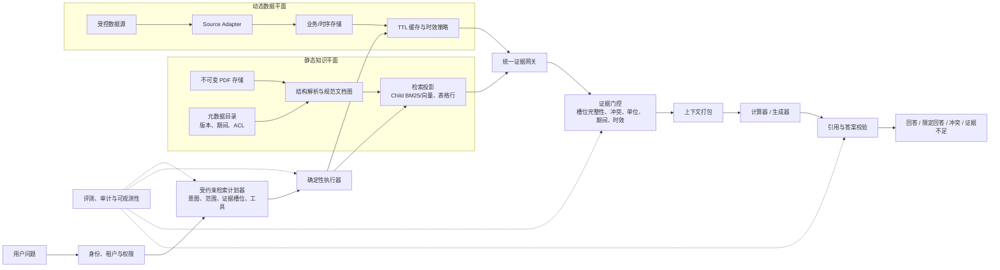

# 企业财务 PDF RAG 顶层设计

## 1. 设计结论

本项目定位为：

> 面向企业财务文档的、可追溯的证据问答系统。

它不是万能知识 Agent，也不是只返回若干相似 chunk 的搜索 Demo。系统的核心产物是一个满足业务约束的 **Evidence Package（证据包）**，生成答案只是证据包通过完整性、一致性、权限和时效检查后的下游动作。

顶层设计遵守四条原则：

1. **先定义检索目标，再选择检索技术。** 检索成功意味着必要证据完整，不意味着 Top-K 相似度足够高。
2. **静态知识与动态数据物理分层。** PDF、实时接口、会话状态和审计日志使用不同的数据生命周期。
3. **证据不足时失败关闭。** 缺少关键证据、来源冲突、数据过期或权限不足时，不生成无条件结论。
4. **评测服务于系统契约。** 每层指标回答该层是否履约，不能用一个综合分数掩盖局部失败。

## 2. 场景定位与检索目标

### 2.1 目标用户与数据

- 目标用户：企业内部分析人员、财务研究人员和需要核验报告内容的业务人员。
- 核心数据：年报、季报、财务说明、制度文件等经过授权的企业 PDF。
- 典型任务：
  - 查找某公司某期间的财务数字、定义或事实。
  - 对同一公司不同期间的数据进行可比性检查后再比较。
  - 从表格和正文中组合多个证据回答问题。
  - 对检索到的明确输入执行可复现的公式计算。
  - 返回可定位到 PDF、版本、页码和表格结构的引用。

### 2.2 检索目标

检索层的目标不是“找几个与问题相似的文本块”，而是：

> 在租户、权限、公司、文档类型、报告期间、版本和时间语义约束下，找齐回答问题所需的证据槽位，并保留证据的父级结构、单位、表头和来源。

一个标准证据包可抽象为：

```text
EvidencePackage
  query_scope:
    tenant_id, company, document_type, fiscal_period, as_of
  required_slots:
    - slot_name
    - status: filled | missing | conflicting
    - evidence_ids
  evidence:
    - content
    - document_id, document_version
    - page_number, section_id, structure_type
    - unit, fiscal_period
    - valid_at, retrieved_at
    - retrieval_score, provenance
  conflicts
  completeness_score
  decision: answer | qualified | conflict | insufficient
```

例如，“2023 年 A 公司的流动比率是多少”不能只检索到“流动资产”。证据包至少需要：

- 正确公司、报告期和文档版本。
- 流动资产数值、单位和对应表头。
- 流动负债数值、单位和对应表头。
- 计算公式或明确的计算语义。
- 两个数值在期间和口径上可比较。

只有这些槽位齐全，计算器才能执行除法，生成器才能解释结果。

### 2.3 框架必须实现的能力

| 能力域 | 必须具备的功能 |
| --- | --- |
| 数据接入 | PDF 原文件留存、内容哈希、去重、版本记录、解析状态 |
| 结构解析 | 文档、页、章节、段落、表格、表头、表行和 chunk 的父子关系 |
| 检索规划 | 识别意图、范围、证据槽位和可调用工具；输出受约束的结构化计划 |
| 检索执行 | Child chunk 混合检索、表格行检索、父子展开、元数据前置过滤 |
| 证据组装 | 按问题而非按单条结果打包上下文，保留表格原子性和引用关系 |
| 证据门控 | 检查槽位完整性、版本、期间、单位、冲突、时效和权限 |
| 推理生成 | 确定性计算优先；答案包含引用；证据不足时受控拒答 |
| 评测治理 | 分层评测、计划回放、bad case 归因、回归门禁和运行可观测性 |

## 3. 分层存储架构

### 3.1 静态知识平面

静态知识是发布后内容不频繁变化、可以版本化重建的资料。

| 层级 | 存储内容 | 建议载体 | 一致性要求 |
| --- | --- | --- | --- |
| L0 原始来源层 | 原始 PDF、内容哈希、接入时间 | 对象存储 | 不可变，版本追加 |
| L1 规范知识层 | 文档图：文档→页→章节→表格/段落→chunk | 关系型或文档数据库 | 系统事实源 |
| L2 检索投影层 | Child chunk 的 BM25/向量索引、表格行索引 | 搜索引擎/向量库 | 可从 L1 重建 |
| 控制面 | 公司、期间、文档类型、ACL、解析器/索引版本 | 元数据目录 | 强校验、可审计 |

关键约束：

- 向量库不是事实源，只是可重建的检索投影。
- 每个 chunk 必须保存 `document_id`、`document_version`、`page_number`、`parent_id`、`structure_type` 和权限元数据。
- 表格行可以作为检索子单元，但返回上下文时必须带回表头和必要父结构。
- 文档新版本进入后生成新索引版本；旧版本按审计策略保留，不能静默覆盖。

### 3.2 动态数据平面

动态数据包括市场行情、ERP 指标、库存、当前汇率或其他会随时间变化的数据。它们不能被当作普通 PDF chunk 长期写入静态向量库。

| 组件 | 职责 |
| --- | --- |
| Source Adapter | 调用受控 API、数据库或事件流，完成鉴权和字段映射 |
| Operational/Time-series Store | 保存当前值或时间序列，支持明确的 `as_of` 查询 |
| TTL Cache | 降低访问成本，同时记录过期时间和原始来源 |
| Freshness Policy | 定义不同数据类型允许的最大陈旧时间 |

每条动态证据至少携带：

```text
source_system, observed_at, valid_at, expires_at, retrieved_at
```

用户问“最新”“当前”“截至现在”时，由计划器选择动态数据工具；用户问已发布年报中的历史数字时，优先走静态知识平面。动态连接器不可用或数据过期时，系统必须说明时效限制，不能用历史 PDF 数字冒充实时数据。

### 3.3 运行时与审计平面

- 查询计划、会话状态和短期结果缓存属于运行时数据，不属于企业知识。
- 生成答案、引用、模型版本、检索计划、证据 ID 和延迟写入审计日志。
- 用户反馈和评测标注进入评测数据集，经过审核后才能成为长期知识或测试基线。
- 静态知识、动态数据、会话记忆和评测数据之间禁止无治理地互相回写。

## 4. 目标架构



可编辑版本见 [rag_top_level_architecture.drawio](rag_top_level_architecture.drawio)。

统一证据网关只统一证据协议，不把所有数据物理合并到一个库。执行器必须先做权限和范围过滤，再做排序和上下文组装。

## 5. 能力边界

### 5.1 支持范围

| 类型 | 系统承诺 |
| --- | --- |
| 文档事实问答 | 在已接入且有权限的文档中查找事实并提供页级引用 |
| 表格数值问答 | 保留表头、单位、期间和父表结构后回答 |
| 文档内综合 | 从多个页或章节组装完整证据包 |
| 有约束的跨文档比较 | 只有公司、期间、单位和会计口径可比较时才执行 |
| 确定性计算 | 输入证据齐全后由计算器执行并展示依据 |
| 动态事实查询 | 仅在对应连接器、权限和时效 SLA 均满足时支持 |

### 5.2 条件支持

- OCR 文档、图表和复杂跨页表格：只有解析质量达到阈值时才回答。
- 跨公司比较：必须先完成单位、币种、期间和口径归一。
- 多轮追问：会话只补充查询范围，不作为事实来源。
- 多源冲突：能够展示冲突；只有权威性和时间规则可裁决时才选择结论。

### 5.3 明确不支持

- 投资建议、未来预测和文档未表达的因果推断。
- 没有动态数据连接器时回答实时行情或当前经营数据。
- 代替审计、法务或财务专业人员给出具有权威性的结论。
- 在关键输入缺失时猜测数值或补全计算。
- 超出用户数据权限的跨租户检索。
- 让生成模型直接执行具有外部副作用的业务操作。

### 5.4 四种响应状态

| 状态 | 条件 | 行为 |
| --- | --- | --- |
| `ANSWERED` | 证据完整、一致、未过期且有权限 | 给出答案和引用 |
| `QUALIFIED` | 部分证据可回答有限范围，限制可以明确表达 | 给出限定结论和缺失项 |
| `CONFLICT` | 权威来源之间存在无法自动消解的冲突 | 展示冲突来源，不替用户裁决 |
| `INSUFFICIENT` | 必要槽位缺失、数据过期、解析失败或无权限 | 拒绝确定回答并说明原因 |

硬性拒答条件包括：来源不确定、必要槽位缺失、期间或单位歧义未解决、动态数据已过期、引用无法定位、权限检查失败。

## 6. 设计不变量

后续实现和调参不得破坏以下约束：

1. 原始问题始终参与检索，计划器只能补充受约束的子查询。
2. 计划器负责决策，执行器负责确定性执行；计划器不能绕过权限和证据门控。
3. 元数据权限过滤发生在排序前，生成阶段不能补救越权检索。
4. 每条证据必须有来源、版本、结构位置和时间语义。
5. 表格证据保留表头和必要父结构，不做破坏结构的句子压缩。
6. 索引可以重建，规范知识层才是事实源。
7. 静态与动态数据不共享更新周期，统一的是证据协议而不是物理存储。
8. 证据包未通过门控时，生成模型不能给出无条件答案。
9. 分层指标分别负责数据、检索、证据组装和生成，不能用一个总分替代。

## 7. 分层评测契约

| 阶段 | 需要回答的问题 | 核心指标 |
| --- | --- | --- |
| 数据接入 | 原始证据是否可用且元数据完整 | PDF 可用率、页码元数据覆盖率、解析成功率、表格结构完整率、版本新鲜度 |
| 计划器 | 是否选择了正确范围、槽位和工具 | Schema 合法率、回退率、工具选择准确率、证据槽位规划准确率 |
| 细粒度检索 | 关键证据是否进入候选集 | Source Hit/MRR、证据页/证据 span/表格行 Recall@K、nDCG、延迟 |
| 证据组装 | 父结构是否补全，噪声和冲突是否受控 | Slot Recall、证据完整率、Context Precision、冲突检测准确率、陈旧证据率 |
| 生成 | 答案是否有据、相关、正确 | Faithfulness、Answer Relevancy、Answer Correctness、Context Recall、Noise Sensitivity |
| 引用与拒答 | 系统是否知道何时不能答 | Citation Correctness、拒答 Precision/Recall、权限违规数（必须为 0） |
| 运行质量 | 是否能在业务约束内稳定运行 | P50/P90/P99 延迟、失败率、成本、缓存命中率、计划可回放率 |

`Reference-term Recall` 仅保留为 bad case 的词面诊断，不作为语义召回或切分质量的主指标。

## 8. 当前实现状态

### 8.1 当前已经具备

- PDF 静态知识接入、页码等元数据和持久化向量索引。
- Child chunk 与表格行各自独立的 BM25/向量/RRF 混合检索及父子结构展开。
- BGE Cross-Encoder 对融合候选进行精排。
- Agent 检索计划器和确定性执行器。
- 租户、ACL、公司、期间、文档类型和版本在 BM25/向量排序前过滤。
- 元数据范围约束、上下文打包和表格原子化。
- SQL 动态事实网关及可替换的业务 Source Adapter 协议；动态事实不写入向量库。
- 规范化 `EvidencePackage`、Evidence Slot 履约、元数据/动态值冲突检测。
- `ANSWERED/QUALIFIED/CONFLICT/INSUFFICIENT` 四态生成门控。
- 检索评测、RAGAS 生成评测、计划回放和回归比较。

离线报告同时记录 Evidence Slot 平均完整率、完整回答率、四态分布、
缺失槽总数和冲突 case 数，使“召回到相似内容”与“回答证据已经找齐”
成为两个独立、可解释的质量结论。

生产部署时，业务系统需要实现 `StructuredDataProvider` 接口以连接正式
SQL/API 数据源，并由身份服务生成 `RetrievalRequest`。LLM 只能选择证据
工具和声明业务范围，不能创建或扩大租户与 ACL 权限。
